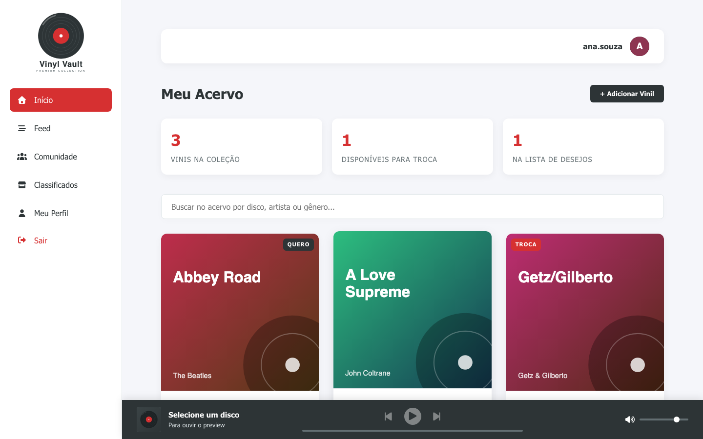
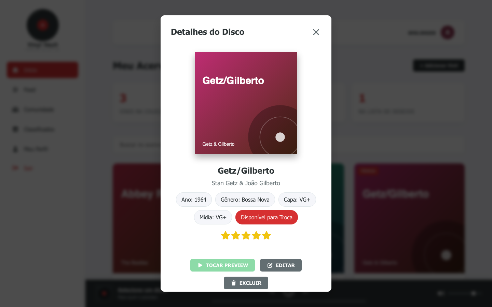
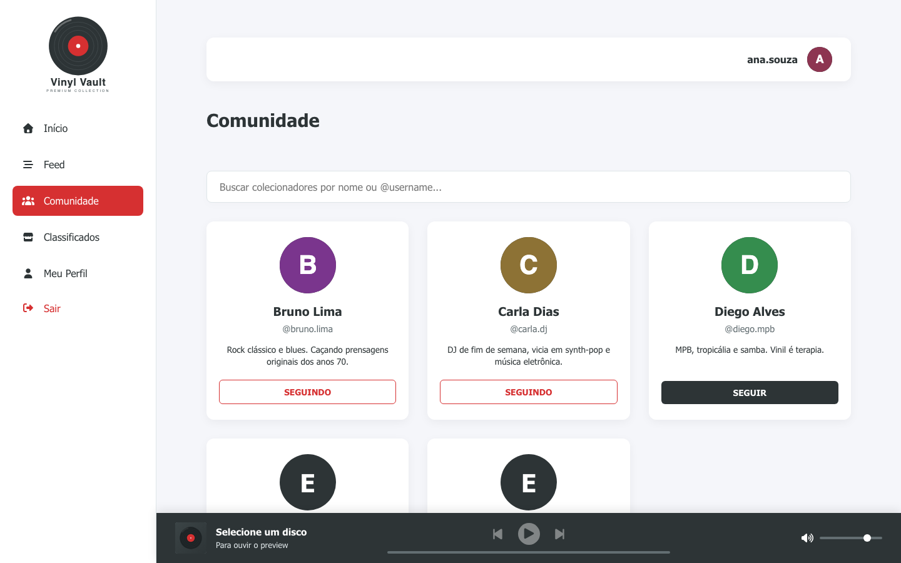
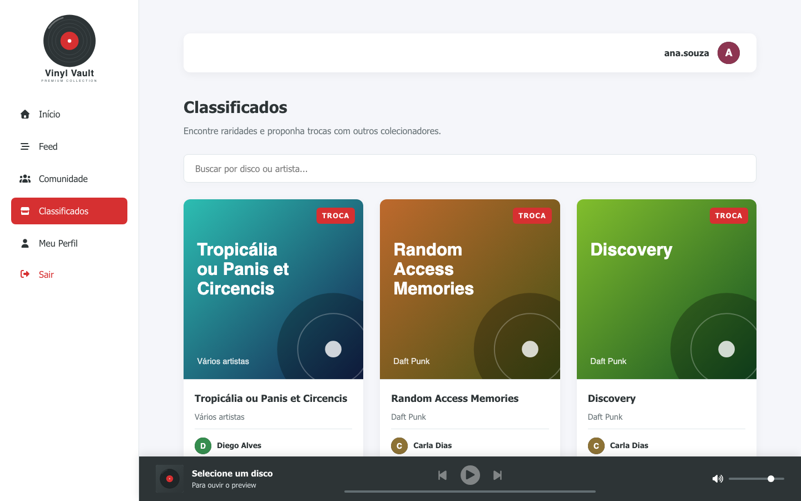
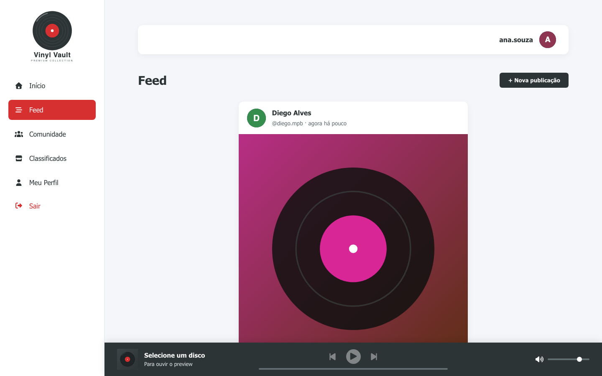
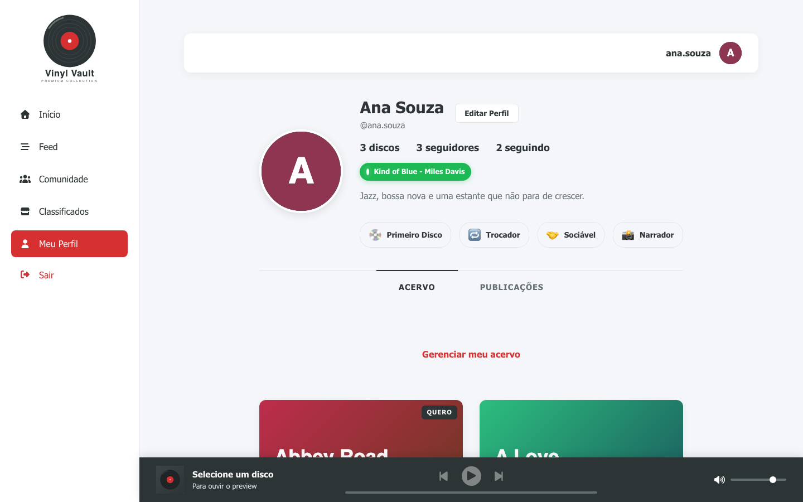
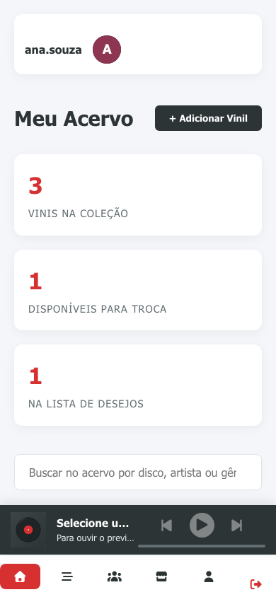
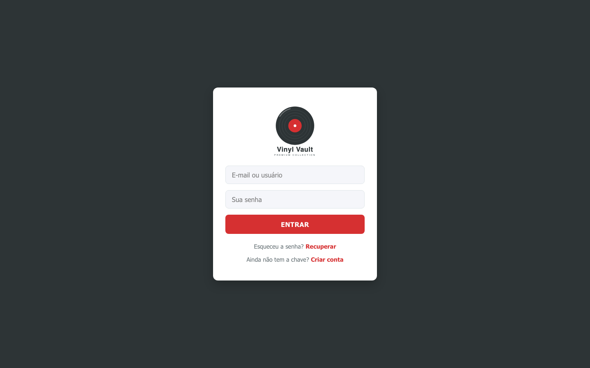
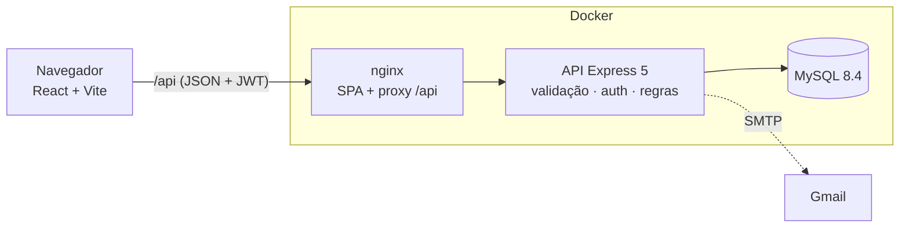

<div align="center">


# Vinyl Vault

**Organize sua coleção de discos de vinil, descubra outros colecionadores e troque raridades.**

[](https://github.com/isabelaohanadev/vinyl-vault/actions/workflows/ci.yml)


</div>

<p align="center">
  
  
</p>

## Sumário

[Funcionalidades](#funcionalidades) · [Tecnologias](#tecnologias) · [Arquitetura](#arquitetura) · [Como rodar](#como-rodar) · [Configuração](#configuração) · [Testes e qualidade](#testes-e-qualidade) · [API](#api) · [Segurança](#segurança) · [CI/CD](#cicd) · [Deploy](#deploy) · [Estrutura](#estrutura-do-projeto) · [Roadmap](#roadmap)

## Funcionalidades

- **Acervo pessoal**: cadastre discos com capa, ano, gênero, estado da capa e da mídia (escala M/NM/VG+/VG/G/P), nota de 0 a 5 estrelas, link do Spotify e preview de áudio. Edite, exclua, busque e mantenha uma **lista de desejos**.
- **Player de áudio global**: toque o preview de um disco e continue navegando; fila, barra de progresso, volume e controle por teclado.
- **Classificados**: veja os discos que outros colecionadores colocaram para troca, com busca por título ou artista.
- **Comunidade**: encontre colecionadores, siga e deixe de seguir, e visite o perfil de cada um (acervo, publicações, estatísticas e conquistas).
- **Feed**: publique fotos e textos, curta, comente e filtre por `#hashtags`.
- **Conta completa**: cadastro, login por e-mail ou usuário, recuperação de senha por e-mail, edição de perfil, troca de senha e exclusão de conta.
- **Mensagens e notificações**: a API já entrega conversas privadas, notificações (curtidas, comentários, seguidores, mensagens e *matches* de lista de desejos). A interface dessas duas telas está no [roadmap](#roadmap).

<p align="center">
  
  
</p>
<p align="center">
  
  
</p>

<details>
<summary>Versão mobile e tela de login</summary>

<p align="center">
  
  
</p>

</details>

> As capas das capturas de tela são imagens geradas para a demonstração; os dados vêm do script de seed.

## Tecnologias

| Camada | Stack |
| --- | --- |
| Frontend | React 19, React Router 7, Vite 7, Axios, Font Awesome (local), CSS puro |
| Backend | Node.js 22+, Express 5, `mysql2` (pool), JWT, bcrypt, Zod, Helmet, `express-rate-limit`, Nodemailer |
| Banco | MySQL 8.4 |
| Testes | `node:test` + Supertest (backend, contra MySQL real) · Vitest + Testing Library (frontend) |
| Infra | Docker, Docker Compose, nginx, GitHub Actions, GitHub Container Registry |

## Arquitetura



- O navegador fala com **uma origem só** (`/api`): em produção o nginx faz o proxy; em desenvolvimento, o Vite. Por isso não há configuração de CORS para o caso comum.
- A API é organizada em `rotas → validação (Zod) → controllers → MySQL`. Quem age é sempre o usuário do token (o servidor nunca confia em ids vindos do cliente) e todas as regras de posse (só o dono edita) são aplicadas no servidor.

## Como rodar

### Com Docker (mais simples)

Precisa de Docker com Compose.

```bash
git clone https://github.com/isabelaohanadev/vinyl-vault.git
cd vinyl-vault

cp .env.example .env
# edite o .env e defina JWT_SECRET (gere com: openssl rand -hex 32)

docker compose up --build
```

Abra **http://localhost:8080**. O MySQL é criado já com o schema ([`database/schema.sql`](database/schema.sql)). Para ter dados de exemplo:

```bash
docker compose exec backend node scripts/seed.js
```

Entre com `ana.souza`, `bruno.lima`, `carla.dj` ou `diego.mpb`; a senha de todos é `demo1234`.

> No modo padrão (`NODE_ENV=development`) os e-mails, como o de recuperação de senha, **aparecem no log** do backend em vez de serem enviados: `docker compose logs backend`.

### Desenvolvimento local

Precisa de **Node 22+** e de um MySQL 8 (o Compose sobe um para você).

```bash
npm run install:all                      # instala backend e frontend

cp backend/.env.example backend/.env     # defina JWT_SECRET (openssl rand -hex 32)
npm run db:up                            # MySQL no Docker, porta 3307, com o schema aplicado
npm run seed                             # opcional: dados de demonstração

npm run dev                              # API em :3000 e site em http://localhost:5173
```

Já tem um MySQL próprio? Crie o banco, rode `database/schema.sql` nele e ajuste `DB_*` no `backend/.env`.

### Atualizando um banco criado pela versão anterior

Se você já tem um banco da versão antiga do projeto, **faça um backup** e aplique a migração uma única vez:

```bash
mysql -u <usuario> -p <banco> < database/migrations/001_upgrade_legacy_schema.sql
```

Ela amplia o campo do token de recuperação, adiciona `ano`, `estado_capa` e `estado_disco` aos discos e cria as chaves únicas de curtidas e seguidores. Veja os comentários no arquivo (as chaves únicas falham se houver linhas duplicadas).

## Configuração

Variáveis do backend (`backend/.env`; modelo em [`backend/.env.example`](backend/.env.example)). A API **valida tudo ao iniciar** e não sobe com um valor inválido.

| Variável | Padrão | Descrição |
| --- | --- | --- |
| `JWT_SECRET` | – (**obrigatória**) | Segredo de assinatura dos tokens, com 32+ caracteres |
| `DB_HOST` · `DB_PORT` · `DB_USER` · `DB_PASSWORD` · `DB_NAME` | `localhost` · `3306` · – · vazio · – | Conexão com o MySQL (`DB_USER` e `DB_NAME` são obrigatórias) |
| `PORT` | `3000` | Porta da API |
| `NODE_ENV` | `development` | Em `production`, `EMAIL_USER`/`EMAIL_PASS` passam a ser obrigatórios e o segredo de exemplo é recusado |
| `JWT_EXPIRES_IN` | `7d` | Validade do token |
| `BCRYPT_ROUNDS` | `12` | Custo do hash de senha |
| `CORS_ORIGIN` | `http://localhost:5173` | Origens permitidas (separadas por vírgula) |
| `FRONTEND_URL` | `http://localhost:5173` | Base do link enviado no e-mail de recuperação |
| `TRUST_PROXY` | `0` | Quantos proxies existem entre a internet e a API (veja [Deploy](#deploy)) |
| `RATE_LIMIT_ENABLED` | `true` | Liga o limite de requisições |
| `EMAIL_USER` · `EMAIL_PASS` | vazio | Gmail e **senha de app** para enviar e-mails |
| `FEEDBACK_TO` | `EMAIL_USER` | Destino das mensagens do formulário de feedback |

O frontend não precisa de configuração. Para apontar para uma API em outro domínio, defina `VITE_API_URL` no build ([`frontend/.env.example`](frontend/.env.example)). Para o Docker Compose, veja o [`.env.example`](.env.example) da raiz.

## Testes e qualidade

```bash
npm run lint     # ESLint no backend e no frontend
npm test         # backend + frontend
npm run build    # build de produção do frontend
```

- **Backend**: testes de integração com Supertest contra um **MySQL real**. Eles aplicam o `schema.sql` de verdade, cobrem autenticação, regras de posse (inclusive tentativas de acesso a recursos de outras pessoas), validação, paginação e notificações. Por padrão usam `127.0.0.1:3307` com o usuário `vinyl`; `npm run db:up` já cria o banco `vinylvault_test` (na primeira vez, com o volume vazio). Variáveis `TEST_DB_*` permitem apontar para outro MySQL.
  > Os testes **apagam todas as tabelas** do banco que usam. Por segurança, `tests/setup.js` se recusa a rodar se o nome do banco não terminar em `_test` e nunca lê o seu `backend/.env`.
- **Frontend**: Vitest + Testing Library cobrindo contextos, hooks, fluxos de autenticação, acervo, comunidade, feed e player.
- O fluxo completo também foi exercitado em navegador real (cadastro, CRUD de discos, player, comunidade, classificados, feed, recuperação de senha, layout mobile) contra o ambiente Docker.

## API

REST em JSON sob `/api`, autenticada com `Authorization: Bearer <token>`. Referência completa, com formatos, limites, códigos de erro e a tabela de mudanças em relação à API anterior, em **[docs/API.md](docs/API.md)**.

| Recurso | Rotas principais |
| --- | --- |
| Autenticação | `POST /auth/register` · `POST /auth/login` · `GET /auth/me` · `POST /auth/forgot-password` · `POST /auth/reset-password` |
| Usuários | `GET/PUT/DELETE /usuarios/:id` · `/:id/vinis` · `/:id/posts` · `/:id/stats` · `/:id/seguir` |
| Acervo | `POST /vinis` · `GET/PUT/DELETE /vinis/:id` · `GET /classificados` |
| Social | `GET /comunidade` · `GET/POST /posts` · `POST /posts/:id/curtir` · `/posts/:id/comentarios` |
| Mensagens | `POST /mensagens` · `GET /mensagens/:amigo_id` · `GET /conversas` · `GET /notificacoes` |

## Segurança

O projeto original não tinha autenticação (qualquer pessoa podia editar ou apagar qualquer conta). A refatoração tratou isso e mais:

- **Autenticação JWT** (HS256, com expiração) e **autorização no servidor**: só o dono edita ou apaga seus recursos; o autor das ações vem do token, nunca do corpo da requisição.
- **Senhas** com bcrypt; login e recuperação de senha **não revelam** se uma conta existe (mesma resposta e mesmo tempo); o token de recuperação é de uso único, expira em 60 minutos e só seu hash fica no banco.
- **Validação** de toda entrada com Zod (tipos, tamanhos, URLs `http(s)`, imagens), consultas parametrizadas, busca com curingas escapados.
- **HTTP**: Helmet, CORS restrito, limite de requisições (mais rígido em login e e-mail), limite de tamanho do corpo e erros que nunca vazam detalhes internos.
- **E-mails** com todo conteúdo do usuário escapado (corrige injeção de HTML) e proteção contra injeção de cabeçalhos.
- **Frontend**: Content-Security-Policy e demais cabeçalhos de segurança no nginx; valores de usuário nunca entram em CSS ou HTML sem tratamento.
- **Supply chain**: `npm audit` sem vulnerabilidades conhecidas; Dependabot semanal.
- O backend roda como usuário sem privilégios no container, todos os serviços têm *healthcheck* e o MySQL é publicado apenas em `127.0.0.1`.

Pontos conhecidos (veja [SECURITY.md](SECURITY.md)): o token fica no `localStorage` (a CSP mitiga XSS, mas cookies `httpOnly` seriam mais robustos), não há verificação de e-mail no cadastro e o limite de requisições é por instância (para várias réplicas, use um *store* compartilhado como o Redis).

## CI/CD

Tudo roda no GitHub Actions ([`.github/workflows`](.github/workflows)):

| Workflow | Quando | O que faz |
| --- | --- | --- |
| **CI** (`ci.yml`) | Pull requests e pushes na `main` | ESLint, testes do backend (Node 22 e 24, MySQL 8.4 real) e do frontend, build, e um **teste de fumaça** que sobe toda a stack com `docker compose` |
| **Publish images** (`publish.yml`) | CI verde na `main` | Publica as imagens multi-arquitetura (amd64/arm64) no GitHub Container Registry |
| **Release** (`release.yml`) | Tag `v*.*.*` | Repete o CI, publica as imagens versionadas e cria a *GitHub Release* com notas geradas |

As imagens ficam em `ghcr.io/isabelaohanadev/vinyl-vault-backend` e `ghcr.io/isabelaohanadev/vinyl-vault-frontend` (`latest`, `sha-<curto>` e, nas releases, `1.2.3` e `1.2`). Os workflows usam só o `GITHUB_TOKEN`: não é preciso cadastrar segredos. Para lançar uma versão:

```bash
git tag v1.0.0 && git push origin v1.0.0
```

## Deploy

O caminho mais direto é um servidor (VPS) com Docker, rodando o Compose atrás de um proxy com HTTPS:

1. Copie o repositório (ou só `docker-compose.yml` e `database/`) e crie o `.env` com:
   - `JWT_SECRET` forte, `NODE_ENV=production`, `EMAIL_USER`/`EMAIL_PASS` (Gmail com senha de app) e `FEEDBACK_TO`;
   - `PUBLIC_URL=https://seu-dominio` (usado em CORS e nos links de e-mail);
   - **senhas novas** para `MYSQL_ROOT_PASSWORD` e `MYSQL_PASSWORD`.
2. `docker compose up -d --build`. Para usar as imagens já publicadas, troque `build:` por `image: ghcr.io/isabelaohanadev/vinyl-vault-backend:latest` (e `-frontend`).
3. Coloque um proxy TLS na frente da porta `8080` (exemplo com Caddy):
   ```
   seu-dominio.com {
       reverse_proxy localhost:8080
   }
   ```
   Como agora há **dois** proxies (Caddy e o nginx do projeto), defina `TRUST_PROXY=2`; do contrário o limite de requisições enxerga todos os visitantes como um único IP.
4. Faça **backup** do volume do MySQL (`mysqldump`) regularmente.

O frontend também pode ser publicado em hospedagem estática (`npm run build`, pasta `frontend/dist`) com a API em outro domínio: defina `VITE_API_URL` no build e inclua a origem do site em `CORS_ORIGIN`.

## Estrutura do projeto

```
vinyl-vault/
├── backend/                 API Express
│   ├── src/
│   │   ├── config/          env validado (Zod), pool MySQL, e-mail
│   │   ├── middlewares/     auth (JWT), validação, rate limit, erros
│   │   ├── schemas/         schemas Zod de cada recurso
│   │   ├── controllers/     regras de negócio
│   │   ├── routes/          mapeamento das rotas
│   │   ├── services/        notificações
│   │   └── utils/           token, serializers, helpers
│   ├── scripts/seed.js      dados de demonstração
│   └── tests/               unitários e de integração
├── frontend/                React + Vite
│   ├── src/
│   │   ├── components/      Modal, PostCard, Player, formulários...
│   │   ├── contexts/        autenticação e player de áudio
│   │   ├── hooks/           useAuth, useFetch, usePagedFetch...
│   │   ├── lib/             cliente da API e utilitários
│   │   ├── pages/           telas
│   │   └── styles/          CSS
│   └── nginx/               configuração do servidor de produção
├── database/
│   ├── schema.sql           schema completo (idempotente)
│   └── migrations/          migração de bancos da versão anterior
├── docs/                    API.md e capturas de tela
├── .github/                 workflows, Dependabot, template de PR
└── docker-compose.yml
```

## Roadmap

- Telas de **mensagens** e **notificações** (a API e os estilos já existem).
- Busca automática de capa, ano e preview de áudio (Spotify/iTunes) ao cadastrar um disco; hoje os links são informados manualmente.
- Upload de imagens (hoje são URLs ou *base64*).
- Opção de compartilhar o que você está ouvindo (`tocando_agora`), com consentimento.
- Verificação de e-mail e sessão por cookie `httpOnly` com renovação de token.
- Scroll infinito nas listas, PWA e internacionalização.

## Contribuindo

Veja [CONTRIBUTING.md](CONTRIBUTING.md). Vulnerabilidades: [SECURITY.md](SECURITY.md).

## Licença

[ISC](LICENSE) © 2026 Isabela Ohana
