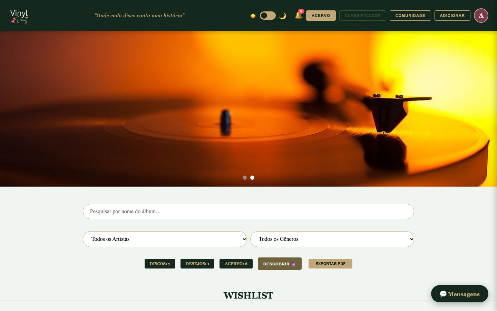
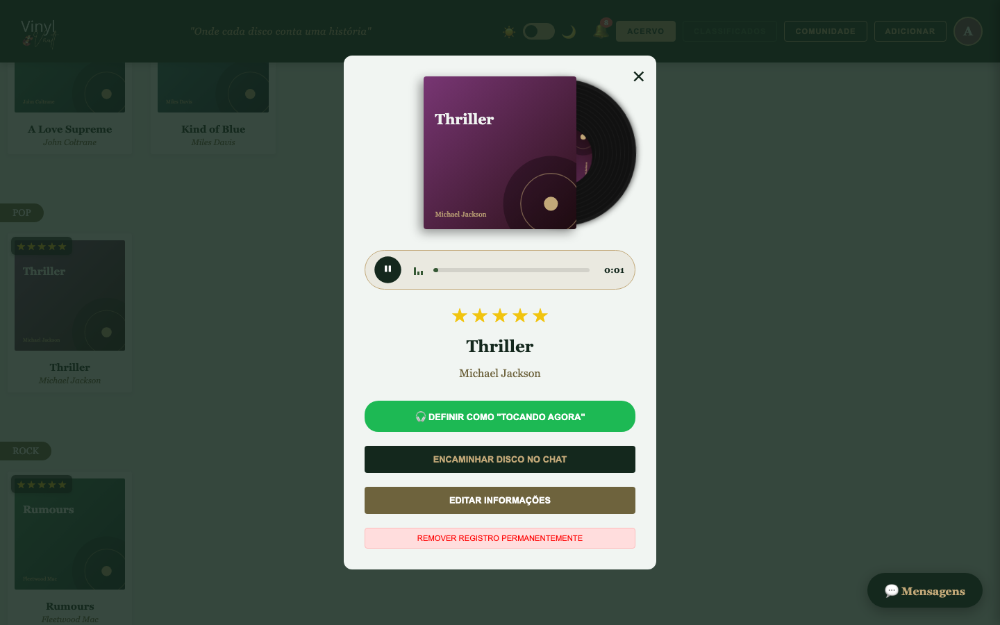
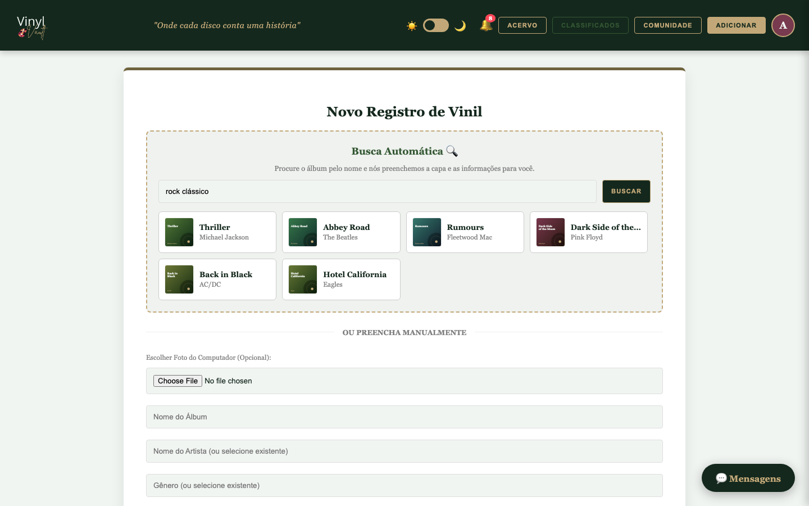
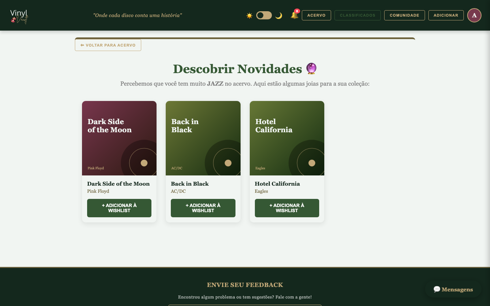
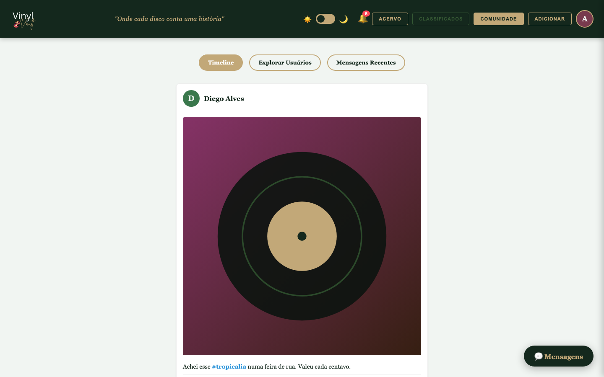
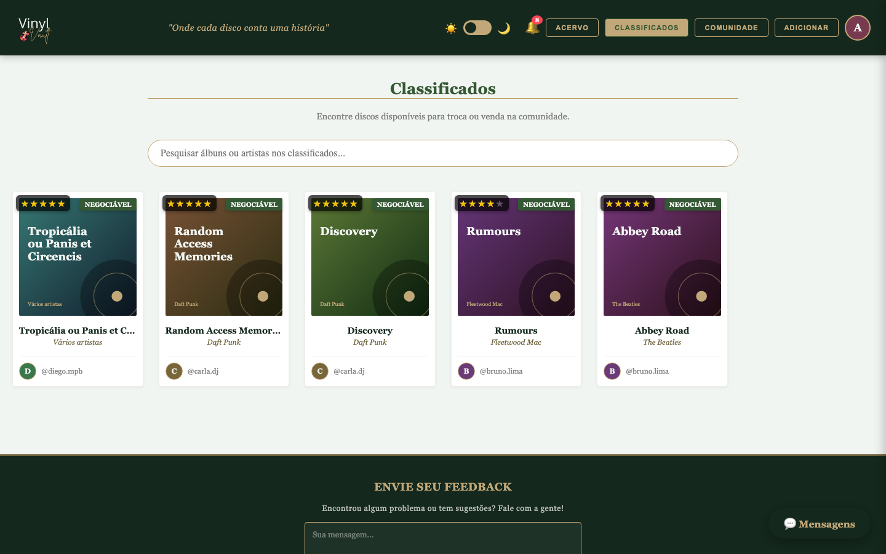
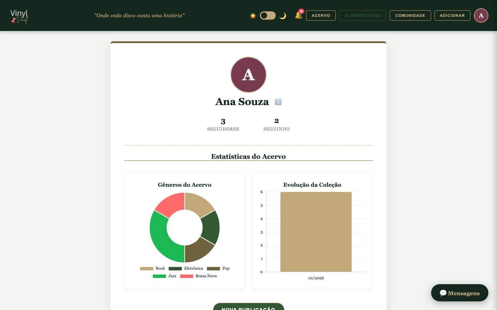
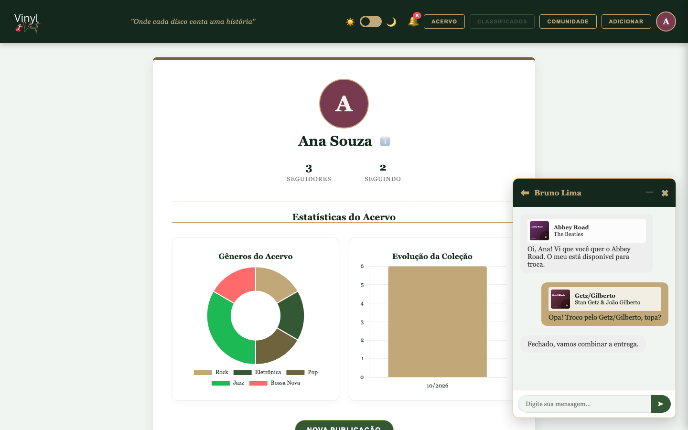
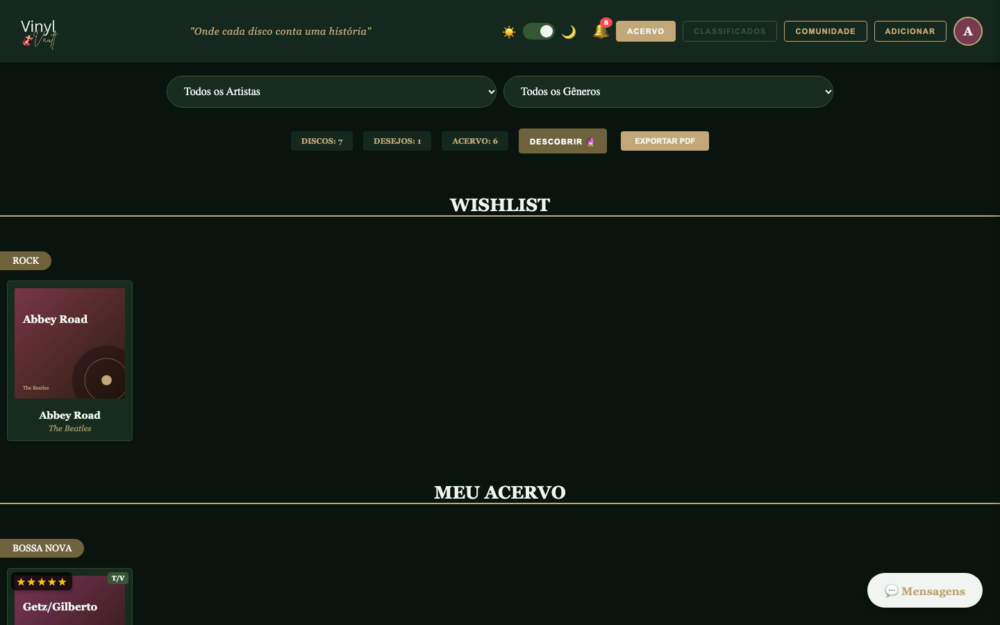
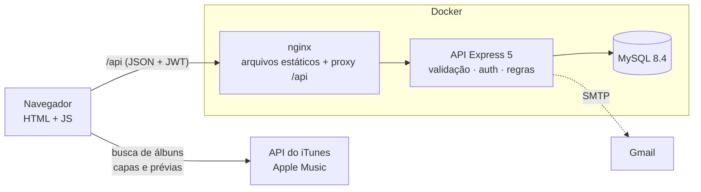

<div align="center">


# Vinyl Vault

**Onde cada disco conta uma história.** Organize sua coleção de discos de vinil, descubra novos álbuns, toque prévias, conheça outros colecionadores e troque raridades.

[](https://github.com/isabelaohanadev/vinyl-vault/actions/workflows/ci.yml)


</div>

<p align="center">
  
</p>

## Sumário

[Funcionalidades](#funcionalidades) · [Tecnologias](#tecnologias) · [Arquitetura](#arquitetura) · [Como rodar](#como-rodar) · [Configuração](#configuração) · [Testes e qualidade](#testes-e-qualidade) · [API](#api) · [Segurança](#segurança) · [CI/CD](#cicd) · [Deploy](#deploy) · [Estrutura](#estrutura-do-projeto) · [Roadmap](#roadmap)

## Funcionalidades

**Acervo**
- Discos em duas prateleiras, **Wishlist** e **Meu Acervo**, agrupados por gênero, com nota de 1 a 5 estrelas e selo **T/V** (troca/venda).
- Busca por nome e filtros por artista e gênero; contadores de discos, desejos e acervo.
- **Busca automática** pela API do iTunes/Apple Music: digite o nome do álbum e a capa, o artista, o gênero e a **prévia de áudio** são preenchidos.
- **Descobrir 🔮**: recomendações de álbuns do seu gênero favorito (sem repetir o que você já tem) e inclusão na wishlist em um clique.
- **Exportar PDF** da coleção e **gráficos** (gêneros do acervo e evolução ao longo do tempo).

**Ouvir**
- Ao abrir um disco, o **vinil desliza para fora da capa e gira enquanto a prévia toca**, com player próprio (progresso, ondas e tempo).
- **"Tocando agora"**: defina o que você está ouvindo; aparece no seu menu, na comunidade, no perfil e nas conversas.

**Comunidade**
- **Timeline** com fotos, curtidas, comentários em *thread* com respostas e **#hashtags** filtráveis; página própria de cada publicação.
- **Explorar usuários**, seguir e deixar de seguir, **perfis públicos** (acervo, classificados, publicações, seguidores e seguindo) e **selos de conquista** (Iniciante, Curador, Lenda do Vinil, Socialite).
- **Classificados**: discos que outros colecionadores colocaram para troca ou venda, com **chat flutuante** para negociar e opção de **encaminhar um disco** na conversa.
- **Notificações** (seguidores, curtidas, comentários, mensagens e *matches* quando alguém coloca para troca um disco da sua wishlist).

**Conta e extras**
- Cadastro em duas etapas (com foto), login, **recuperação de senha por e-mail**, edição de perfil e exclusão de conta.
- **Tema claro e escuro**, carrossel de banners, layout responsivo, página "Sobre Nós" e formulário de feedback por e-mail.

<p align="center">
  
  
</p>
<p align="center">
  
  
</p>
<p align="center">
  
  
</p>
<p align="center">
  
  
</p>

<details>
<summary>Celular e tela de login</summary>

<p align="center">
  
  
</p>

</details>

> As capas e fotos de perfil das capturas de tela são imagens geradas para a demonstração; os dados vêm do script de seed.

## Tecnologias

| Camada | Stack |
| --- | --- |
| Interface | HTML, CSS e JavaScript puros (sem etapa de build), Chart.js e html2pdf.js (embutidos em `frontend/vendor`), API pública do iTunes |
| Backend | Node.js 22+, Express 5, `mysql2` (pool), JWT, bcrypt, Zod, Helmet, `express-rate-limit`, Nodemailer |
| Banco | MySQL 8.4 |
| Testes | `node:test` + Supertest (API, contra MySQL real) · Playwright (interface, 44 testes em navegador real) |
| Infra | Docker, Docker Compose, nginx, GitHub Actions, GitHub Container Registry |

## Arquitetura



- O navegador fala com **uma origem só** (`/api`): em produção o nginx faz o proxy; em desenvolvimento, o `dev-server.js`. Por isso não há configuração de CORS para o caso comum.
- A busca de álbuns, as capas e as prévias vêm direto da API do iTunes (o token de sessão **nunca** é enviado para ela).
- A API é organizada em `rotas → validação (Zod) → controllers → MySQL`. Quem age é sempre o usuário do token (o servidor nunca confia em ids vindos do cliente) e as regras de posse (só o dono edita) são aplicadas no servidor.

## Como rodar

### Com Docker (mais simples)

Precisa de Docker com Compose.

```bash
git clone https://github.com/isabelaohanadev/vinyl-vault.git
cd vinyl-vault

cp .env.example .env
# edite o .env e defina JWT_SECRET (gere com: openssl rand -hex 32)

docker compose up --build
```

Abra **http://localhost:8080**. O MySQL é criado já com o schema ([`database/schema.sql`](database/schema.sql)). Para ter dados de exemplo:

```bash
docker compose exec backend node scripts/seed.js
```

Entre com `ana.souza`, `bruno.lima`, `carla.dj` ou `diego.mpb`; a senha de todos é `demo1234`. Ou crie a sua própria conta.

> No modo padrão (`NODE_ENV=development`) os e-mails, como o de recuperação de senha, **aparecem no log** do backend em vez de serem enviados: `docker compose logs backend`.

### Desenvolvimento local

Precisa de **Node 22+** e de um MySQL 8 (o Compose sobe um para você).

```bash
npm run install:all                      # instala backend e frontend

cp backend/.env.example backend/.env     # defina JWT_SECRET (openssl rand -hex 32)
npm run db:up                            # MySQL no Docker, porta 3307, com o schema aplicado
npm run seed                             # opcional: dados de demonstração

npm run dev                              # API em :3000 e o app em http://localhost:5173
```

Já tem um MySQL próprio? Crie o banco, rode `database/schema.sql` nele e ajuste `DB_*` no `backend/.env`.

### Atualizando um banco criado pela versão anterior

Se você já tem um banco da versão antiga do projeto (a do servidor único, antes da refatoração), **faça um backup** e aplique a migração uma única vez:

```bash
mysql -u <usuario> -p <banco> < database/migrations/001_upgrade_legacy_schema.sql
```

Ela amplia o campo do token de recuperação, adiciona `ano`, `estado_capa` e `estado_disco` aos discos e cria as chaves únicas de curtidas e seguidores. Veja os comentários no arquivo (as chaves únicas falham se houver linhas duplicadas). Os usuários e senhas existentes continuam funcionando (as senhas já eram *hashes* bcrypt); só as **novas** senhas precisam ter 8 ou mais caracteres.

### Foto da página "Sobre Nós"

A foto exibida em "Sobre Nós" (`frontend/assets/iandj.jpg`) é pessoal e **não é versionada** no Git. Coloque o arquivo nessa pasta para vê-la; sem ele, a página simplesmente esconde a imagem. Para publicá-la junto ao código, use `git add -f frontend/assets/iandj.jpg`.

## Configuração

Variáveis do backend (`backend/.env`; modelo em [`backend/.env.example`](backend/.env.example)). A API **valida tudo ao iniciar** e não sobe com um valor inválido.

| Variável | Padrão | Descrição |
| --- | --- | --- |
| `JWT_SECRET` | – (**obrigatória**) | Segredo de assinatura dos tokens, com 32+ caracteres |
| `DB_HOST` · `DB_PORT` · `DB_USER` · `DB_PASSWORD` · `DB_NAME` | `localhost` · `3306` · – · vazio · – | Conexão com o MySQL (`DB_USER` e `DB_NAME` são obrigatórias) |
| `PORT` | `3000` | Porta da API |
| `NODE_ENV` | `development` | Em `production`, `EMAIL_USER`/`EMAIL_PASS` passam a ser obrigatórios e o segredo de exemplo é recusado |
| `JWT_EXPIRES_IN` | `7d` | Validade do token |
| `BCRYPT_ROUNDS` | `12` | Custo do hash de senha |
| `CORS_ORIGIN` | `http://localhost:5173` | Origens permitidas (separadas por vírgula) |
| `FRONTEND_URL` | `http://localhost:5173` | Endereço do app; o link do e-mail de recuperação é `<FRONTEND_URL>/?token=…` |
| `TRUST_PROXY` | `0` | Quantos proxies existem entre a internet e a API (veja [Deploy](#deploy)) |
| `RATE_LIMIT_ENABLED` | `true` | Liga o limite de requisições |
| `EMAIL_USER` · `EMAIL_PASS` | vazio | Gmail e **senha de app** para enviar e-mails |
| `FEEDBACK_TO` | `EMAIL_USER` | Destino das mensagens do formulário de feedback |

A interface não precisa de configuração. Ela chama a API em `/api` na mesma origem; para uma API em outro domínio, defina `window.VINYL_API_URL` antes de carregar `scripts/api.js`. Para o Docker Compose, veja o [`.env.example`](.env.example) da raiz.

## Testes e qualidade

```bash
npm run lint        # ESLint no backend e no frontend
npm test            # API: 128 testes de integração contra um MySQL real
npm run test:e2e    # interface: 44 testes em navegador real (precisa do app rodando)
```

- **API**: Supertest contra um **MySQL real**. Os testes aplicam o `schema.sql` de verdade e cobrem autenticação, regras de posse (inclusive tentativas de acesso a recursos de outras pessoas), validação, paginação, limites de requisição e notificações. Por padrão usam `127.0.0.1:3307` com o usuário `vinyl`; `npm run db:up` já cria o banco `vinylvault_test` (na primeira vez, com o volume vazio). Variáveis `TEST_DB_*` permitem apontar para outro MySQL.
  > Os testes **apagam todas as tabelas** do banco que usam. Por segurança, `backend/tests/setup.js` se recusa a rodar se o nome do banco não terminar em `_test` e nunca lê o seu `backend/.env`.
- **Interface (E2E)**: [Playwright](e2e) dirige o app de verdade no Chromium: cadastro e login, recuperação de senha, acervo, busca automática, o disco girando com a prévia, PDF, gráficos, timeline, comentários, comunidade, classificados, chat, notificações, perfil e exclusão de conta, além de **ataques de XSS** em todos os lugares em que o conteúdo de outras pessoas aparece. A API do iTunes, as capas e o áudio são simulados, então não precisa de internet.

  ```bash
  docker compose up -d --build            # com RATE_LIMIT_ENABLED=false no .env, pois os testes criam muitas contas
  cd e2e && npm ci && npx playwright install chromium
  BASE_URL=http://localhost:8080 npx playwright test
  ```

## API

REST em JSON sob `/api`, autenticada com `Authorization: Bearer <token>`. Referência completa, com formatos, limites, códigos de erro e a tabela de mudanças em relação à API anterior, em **[docs/API.md](docs/API.md)**.

| Recurso | Rotas principais |
| --- | --- |
| Autenticação | `POST /auth/register` · `POST /auth/login` · `GET /auth/me` · `POST /auth/forgot-password` · `POST /auth/reset-password` |
| Usuários | `GET/PUT/DELETE /usuarios/:id` · `/:id/vinis` · `/:id/posts` · `/:id/stats` · `/:id/seguir` |
| Acervo | `POST /vinis` · `GET/PUT/DELETE /vinis/:id` · `GET /classificados` |
| Social | `GET /comunidade` · `GET/POST /posts` · `POST /posts/:id/curtir` · `/posts/:id/comentarios` |
| Mensagens | `POST /mensagens` · `GET /mensagens/:amigo_id` · `GET /conversas` · `GET /notificacoes` |

## Segurança

A versão original não tinha autenticação (qualquer pessoa podia editar ou apagar qualquer conta) e inseria textos de outros usuários na página sem escapar. A refatoração tratou isso e mais:

- **Autenticação JWT** (HS256, com expiração) e **autorização no servidor**: só o dono edita ou apaga seus recursos; o autor das ações vem do token, nunca do corpo da requisição.
- **Proteção contra XSS**: nomes, bios, legendas, comentários, mensagens, nomes de álbuns (inclusive os que vêm da API do iTunes), links e imagens passam por funções de escape antes de entrar na página (`frontend/scripts/utils.js`), e o E2E injeta *payloads* reais em todos esses pontos.
- **Senhas** com bcrypt; login e recuperação de senha **não revelam** se uma conta existe (mesma resposta e mesmo tempo); o token de recuperação é de uso único, expira em 60 minutos e só seu hash fica no banco.
- **Validação** de toda entrada com Zod (tipos, tamanhos, URLs `http(s)`, imagens), consultas parametrizadas, busca com curingas escapados.
- **HTTP**: Helmet, CORS restrito, limite de requisições **por usuário** (e por IP para anônimos), mais rígido em login, cadastro e e-mail, limite de tamanho do corpo e erros que nunca vazam detalhes internos.
- **E-mails** com todo conteúdo do usuário escapado e proteção contra injeção de cabeçalhos.
- **Navegador**: Content-Security-Policy e demais cabeçalhos de segurança no nginx; as bibliotecas de terceiros são servidas pelo próprio app (nada de CDN) e o token nunca é enviado a outros domínios.
- **Supply chain**: `npm audit` sem vulnerabilidades conhecidas; Dependabot.
- O backend roda como usuário sem privilégios no container, todos os serviços têm *healthcheck* e o MySQL é publicado apenas em `127.0.0.1`.

Pontos conhecidos (veja [SECURITY.md](SECURITY.md)): o token fica no `localStorage`; a CSP precisa de `'unsafe-inline'` para scripts porque as telas usam `onclick="…"` (a defesa principal é o escape); não há verificação de e-mail no cadastro; e o limite de requisições é por instância (para várias réplicas, use um *store* compartilhado como o Redis).

## CI/CD

Tudo roda no GitHub Actions ([`.github/workflows`](.github/workflows)):

| Workflow | Quando | O que faz |
| --- | --- | --- |
| **CI** (`ci.yml`) | Pull requests e pushes na `main` | testes da API (Node 22 e 24, MySQL 8.4 real), ESLint do backend e do front, lint, testes e build do `frontend-react`, e a **stack Docker completa** com a suíte E2E de 44 testes em navegador real |
| **Publish images** (`publish.yml`) | CI verde na `main` | Publica as imagens multi-arquitetura (amd64/arm64) no GitHub Container Registry |
| **Release** (`release.yml`) | Tag `v*.*.*` | Repete o CI, publica as imagens versionadas e cria a *GitHub Release* com notas geradas |

As imagens ficam em `ghcr.io/isabelaohanadev/vinyl-vault-backend` e `ghcr.io/isabelaohanadev/vinyl-vault-frontend` (`latest`, `sha-<curto>` e, nas releases, `1.2.3` e `1.2`). Os workflows usam só o `GITHUB_TOKEN`: não é preciso cadastrar segredos. Para lançar uma versão:

```bash
git tag v1.0.0 && git push origin v1.0.0
```

## Deploy

O caminho mais direto é um servidor (VPS) com Docker, rodando o Compose atrás de um proxy com HTTPS:

1. Copie o repositório (ou só `docker-compose.yml` e `database/`) e crie o `.env` com:
   - `JWT_SECRET` forte, `NODE_ENV=production`, `EMAIL_USER`/`EMAIL_PASS` (Gmail com senha de app) e `FEEDBACK_TO`;
   - `PUBLIC_URL=https://seu-dominio` (usado em CORS e nos links de e-mail);
   - **senhas novas** para `MYSQL_ROOT_PASSWORD` e `MYSQL_PASSWORD`.
2. `docker compose up -d --build`. Para usar as imagens já publicadas, troque `build:` por `image: ghcr.io/isabelaohanadev/vinyl-vault-backend:latest` (e `-frontend`).
3. Coloque um proxy TLS na frente da porta `8080` (exemplo com Caddy):
   ```
   seu-dominio.com {
       reverse_proxy localhost:8080
   }
   ```
   Como agora há **dois** proxies (Caddy e o nginx do projeto), defina `TRUST_PROXY=2`; do contrário o limite de requisições enxerga todos os visitantes como um único IP.
4. Faça **backup** do volume do MySQL (`mysqldump`) regularmente.

Como a interface é só arquivos estáticos, ela também pode ficar em qualquer hospedagem estática, com a API em outro domínio: defina `window.VINYL_API_URL` e inclua a origem do site em `CORS_ORIGIN`.

## Estrutura do projeto

```
vinyl-vault/
├── frontend/                Interface (HTML + CSS + JS, sem build)
│   ├── index.html
│   ├── scripts/             api.js (cliente da API), utils.js (escape), acervo, comunidade, chat...
│   ├── styles/              CSS por área (tema verde e dourado)
│   ├── assets/              logo, banners
│   ├── vendor/              Chart.js e html2pdf.js (com as licenças)
│   ├── nginx/               configuração do servidor de produção (proxy /api, CSP)
│   └── dev-server.js        servidor de desenvolvimento (estático + proxy /api)
├── backend/                 API Express
│   ├── src/                 config, middlewares, schemas (Zod), controllers, rotas, serviços
│   ├── scripts/seed.js      dados de demonstração
│   └── tests/               unitários e de integração
├── e2e/                     Testes de ponta a ponta (Playwright)
├── database/
│   ├── schema.sql           schema completo (idempotente)
│   └── migrations/          migração de bancos da versão anterior
├── frontend-react/          Migração para React (experimental, não é o app principal)
├── docs/                    API.md e capturas de tela
├── .github/                 workflows, Dependabot, template de PR
└── docker-compose.yml
```

## Roadmap

- Trocar os `onclick="…"` por *event listeners* para fechar a CSP (sem `'unsafe-inline'`).
- Continuar a migração para React em [`frontend-react`](frontend-react) (hoje cobre só parte das telas).
- Busca avançada por artista, ano e gravadora na busca automática; pré-visualização de várias faixas.
- Upload de imagens para armazenamento próprio (hoje as fotos são guardadas como *base64* no banco).
- Verificação de e-mail e sessão por cookie `httpOnly` com renovação de token.
- Paginação infinita nas listas, PWA e internacionalização.

## Contribuindo

Veja [CONTRIBUTING.md](CONTRIBUTING.md). Vulnerabilidades: [SECURITY.md](SECURITY.md).

## Licença

[ISC](LICENSE) © 2026 Isabela Ohana. Desenvolvido por Isabela Ohana.
