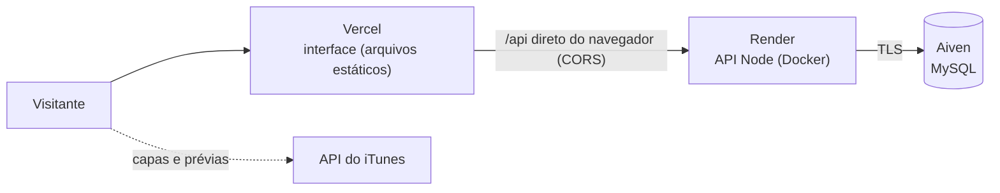

# Publicar de graça (nível portfólio)

Este guia coloca o Vinyl Vault no ar **sem pagar nada e sem cartão de crédito**, para mostrar em portfólio. Não é uma configuração para uso real: o plano gratuito dorme, tem pouco espaço e pode mudar.



| Parte | Serviço | O que esperar |
| --- | --- | --- |
| Interface | [Vercel](https://vercel.com) (plano Hobby) | Sempre no ar. Uso pessoal e sem fins comerciais, o que cobre um portfólio ([regras](https://vercel.com/docs/plans/hobby)) |
| API | [Render](https://render.com) (plano free) | **Dorme após 15 minutos sem uso; a primeira visita depois disso leva cerca de 1 minuto** ([regras](https://render.com/docs/free)). Tem 750 horas por mês |
| Banco | [Aiven](https://aiven.io) (MySQL free) | 1 CPU, 1 GB de RAM e 1 GB de disco, sem prazo e sem cartão. Não é para produção, e o serviço pode ser desligado se ficar sem uso ([regras](https://aiven.io/docs/products/mysql/concepts/mysql-free-tier)) |

Os limites mudam com o tempo: confira as páginas acima antes de começar. Quando o servidor está dormindo, a interface mostra um aviso ("Acordando o servidor gratuito…") em vez de parecer travada.

> **Por que não tudo num lugar só?** A interface é estática e cabe de graça em qualquer hospedagem de sites. A API precisa de um servidor que fique ligado e o MySQL precisa de um banco de verdade; nenhuma hospedagem gratuita oferece os três juntos de forma confiável.

## 1. Banco de dados (Aiven)

1. Crie a conta em [console.aiven.io](https://console.aiven.io) e um serviço **MySQL** no plano **Free**.
2. Espere o estado **Running**. Na página *Overview* do serviço, anote **Host**, **Port**, **User** (`avnadmin`), **Password** e **Database name** (`defaultdb`), e baixe o **CA certificate** (`ca.pem`).

## 2. Criar as tabelas (na sua máquina)

O comando usa o mesmo código da API, então não precisa ter o cliente `mysql` instalado. Na pasta do projeto:

```bash
npm --prefix backend ci

export DB_HOST='...'  DB_PORT='...'  DB_USER='avnadmin'  DB_NAME='defaultdb'
read -rs 'DB_PASSWORD?Senha do banco: '; export DB_PASSWORD     # zsh; no bash use: read -rs -p "Senha do banco: " DB_PASSWORD; export DB_PASSWORD
export DB_SSL=true  DB_SSL_CA="$(cat ~/Downloads/ca.pem)"
export JWT_SECRET="$(openssl rand -hex 32)"                      # só para o script iniciar

npm --prefix backend run db:schema      # cria as 8 tabelas (pode rodar de novo sem problema)
npm --prefix backend run seed           # opcional: colecionadores e discos de demonstração
```

Os colecionadores do `seed` são `ana.souza`, `bruno.lima`, `carla.dj` e `diego.mpb`, todos com a senha `demo1234`. Como a senha é pública, qualquer visitante pode mexer nessas contas: é o que se espera de uma demonstração, mas não coloque dados seus nelas.

Depois, limpe as variáveis do terminal: `unset DB_PASSWORD DB_SSL_CA JWT_SECRET`.

## 3. API (Render)

1. Crie a conta em [render.com](https://render.com) e conecte o seu GitHub.
2. **New → Blueprint**, escolha o repositório `vinyl-vault` e confirme o [`render.yaml`](../render.yaml) da raiz.
3. O Render pergunta o valor das variáveis marcadas como segredo:

   | Variável | Valor |
   | --- | --- |
   | `DB_HOST`, `DB_PORT`, `DB_USER`, `DB_PASSWORD`, `DB_NAME` | Os dados do Aiven (passo 1) |
   | `DB_SSL_CA` | O **conteúdo** do `ca.pem`, com as linhas `-----BEGIN…` e `-----END…` |
   | `EMAIL_USER`, `EMAIL_PASS` | Seu Gmail e uma [senha de app](https://myaccount.google.com/apppasswords) (para o e-mail de recuperação de senha) |
   | `CORS_ORIGIN`, `FRONTEND_URL` | Ainda não sabe o endereço da Vercel: coloque `https://vinyl-vault.vercel.app` por enquanto e corrija no passo 5 |

   O `JWT_SECRET` é gerado pelo próprio Render.
4. Quando o deploy terminar, abra `https://<nome-do-serviço>.onrender.com/api/health`. Deve responder `{"status":"ok","database":"up",...}`. Anote o endereço.

**Sem Gmail?** Troque `NODE_ENV` para `development` no painel do Render. Nesse modo a API não exige `EMAIL_USER`/`EMAIL_PASS`, mas a recuperação de senha **não envia e-mail** (o link aparece só no log do serviço). Para um portfólio costuma bastar; só avise isso no README da demo.

## 4. Interface (Vercel)

1. Crie a conta em [vercel.com](https://vercel.com) (pode entrar com o GitHub) e use **Add New → Project** para importar o repositório.
2. Deixe **Framework Preset: Other** e **Root Directory** vazio. O [`vercel.json`](../vercel.json) já define o comando de build (`frontend/tools/build-static.js`) e a pasta de saída.
3. Em **Environment Variables**, crie `VINYL_API_URL` com o endereço da API (`https://<nome-do-serviço>.onrender.com`). O build acrescenta o `/api` sozinho e **falha com uma mensagem clara** se a variável faltar.
4. **Deploy.** Anote o endereço final (`https://algo.vercel.app`).

## 5. Ligar uma ponta na outra

No painel do Render, em *Environment*, corrija `CORS_ORIGIN` e `FRONTEND_URL` para o endereço real da Vercel (com `https://`, **sem barra no fim**). O serviço reinicia sozinho. Pronto: abra o site e entre com `ana.souza` / `demo1234`.

A primeira chamada pode levar cerca de 1 minuto, se a API estiver dormindo.

## Manter acordado (opcional)

Um serviço que consulta `https://<api>.onrender.com/api/health` a cada 5 a 10 minutos (por exemplo, o plano gratuito do [UptimeRobot](https://uptimerobot.com)) evita que a API durma e mantém o banco em uso. Um serviço sempre ligado consome cerca de 744 horas por mês, quase todas as 750 do plano; se você tiver outros serviços gratuitos no Render, eles entram na mesma conta. Para um portfólio visto de vez em quando, o aviso na interface costuma bastar.

## Atualizações

- A Vercel publica de novo a cada push na `main`.
- O Render faz o mesmo, mas só depois que o CI passa (`autoDeployTrigger: checksPass`).
- Mudou o schema do banco? Rode `npm --prefix backend run db:schema` de novo (e a migração em `database/migrations/`, se houver).

## Problemas comuns

| Sintoma | Causa provável |
| --- | --- |
| O site abre, mas o login mostra "Erro de conexão" | `VINYL_API_URL` errada, ou a API ainda está acordando. Abra `/api/health` direto |
| No console do navegador: *blocked by CORS policy* | `CORS_ORIGIN` no Render diferente do endereço da Vercel (precisa ser idêntico, com `https://` e sem barra no fim) |
| No console: *Content Security Policy … connect-src* | A API não está em `*.onrender.com`. Edite o `connect-src` do [`vercel.json`](../vercel.json) |
| Build da Vercel falha pedindo `VINYL_API_URL` | Falta criar a variável (passo 4). Depois, **Redeploy** |
| Log do Render: *Variáveis de ambiente inválidas* | A mensagem lista a variável que falta ou está errada |
| Log do Render: *self-signed certificate in certificate chain* | `DB_SSL_CA` vazio ou com o conteúdo errado (precisa ser o `ca.pem` do **seu** serviço) |
| "Esqueci a senha" não envia nada | `EMAIL_USER`/`EMAIL_PASS` ausentes ou `NODE_ENV=development`; veja o log do Render |
| Muitos "429" ao testar | O limite de requisições está ligado (é o esperado); espere alguns minutos |

## Cuidados com uma demo pública

- Qualquer pessoa pode criar conta, e as fotos ficam no banco (limite de 1 GB). O cadastro tem limite por IP, mas não há moderação. Se o banco encher ou virar bagunça, rode `npm --prefix backend run seed -- --reset` ou recrie o serviço no Aiven.
- Você pode derrubar tudo quando quiser: apague o serviço no Render, o projeto na Vercel e o banco no Aiven.
- Nada sensível fica no repositório: segredos vão só nos painéis (`sync: false` no blueprint).
